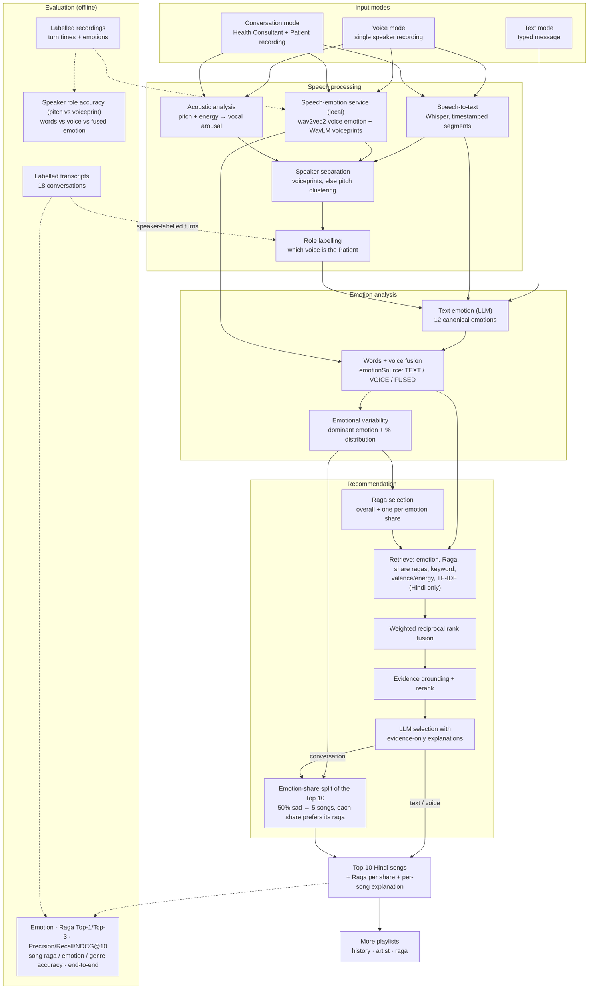

# System architecture

Three input modes feed one emotion → Raga → Top-10 pipeline. Conversation mode (Health Consultant + Patient) is the main focus. Two offline evaluations measure it: one on labelled transcripts (emotion, Raga, song and overall levels) and one on labelled recordings (speaker separation and voice emotion).

| Mode | Emotion comes from | Raga selection | Playlist |
|---|---|---|---|
| Text | the typed words (LLM) | one retrieval source | Top 10 by fused rank |
| Voice | the words and the voice (speech-emotion model), fused; vocal arousal adjusts intensity | one retrieval source | Top 10 by fused rank |
| Conversation | each Patient answer separately, words + voice fused per answer | central: one overall raga, plus one raga per emotion share | Top 10 split across the Patient's emotions by share, each share preferring its own raga |

**Emotion source.** Voice and conversation requests take `emotionSource`: `TEXT` (words only), `VOICE` (the voice decides) or `FUSED` (default). Fusion is a weighted average of the two signals' scores, with voice weight 0.3. On the synthetic test recordings, words alone scored 85%, the voice model alone 40% (4 classes) and fusion at 0.3 kept 85%. At weight 0.5 accuracy fell to 63%, so the voice only decides when the words are clearly ambiguous.

**Speaker separation.** Voiceprints (timbre) are tried first and pitch clustering second. Each only reports a confident split when the two voices are clearly different. Male/female pairs separate reliably. Same-gender synthetic voices are flagged uncertain, and the user can correct roles in the UI.

**Song library.** 121 tracks, including 25 Hindi film songs whose raga comes from a cited source (`database/raga_tagged_hindi_songs.json`). 17 of the 22 catalogue ragas now have Hindi songs. Todi, Marwa, Puriya Dhanashri, Shree and Hindol still have none.
